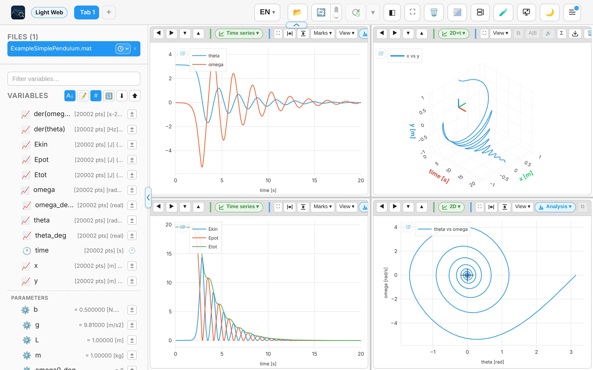

# Time Series Explorer

Time Series Explorer is a browser and desktop application to explore time
series: simulation results, measurements and tabular data. Files are opened by
drag and drop, their signals are plotted in a workspace of linked panels, and
each panel can turn into an analysis (spectrum, distribution, curve fit, …)
without writing code. Everything runs on the user's computer: **files are never
uploaded**.

**▶ [Open the app](https://www.unditas.com/)** · **[User manual](https://www.unditas.com/manual/)** ·
**[Desktop downloads](https://github.com/ferrucci-franco/timeseries-explorer/releases/latest)**
(Windows, macOS, Linux)



Created by [Franco Ferrucci](https://github.com/ferrucci-franco) (GEPASUD
Laboratory, University of French Polynesia). MIT License.

## Who it is for

- **An instrumentation engineer or technician** opens logger and instrument
  files as they come (CSV in any dialect, Excel, audio recordings) and reads
  them with the A|B cursors and the panel statistics, the FFT of a vibration
  and the digital filter. Live Update, in the desktop edition, follows a logger
  while it writes, and a phone is enough to check a file on site. Example:
  *Noisy Chirp Fourier Transform*.
- **A simulation engineer** opens OpenModelica and Dymola results with their
  model tree, overlays several runs, hovers to read the parameters that differ
  between them, and turns a panel into a phase plot or a state animation.
  Example: *Simple Pendulum*.
- **A teacher** has nothing to install: the app runs in the browser on the
  students' own devices, with bundled examples and an animated guide, and in
  class a plot turns into its FFT or a phase plot in two clicks. Example:
  *Lorenz Attractor*.
- **A scientist or researcher** fits curves and reads their equations and R²,
  measures correlation, spectra and integrals (the numerical results are
  checked against NumPy and SciPy), saves views and projects to reproduce a
  figure, and exports data and figures. The files never leave the computer.
  Example: *Correlation and Curve Fitting*.
- **A data analyst** opens large CSV and Parquet files in memory-saving mode,
  on an embedded DuckDB engine, then uses the calendar heatmap, the temporal
  profile, resampling and derived variables written as formulas. Example:
  *Power Grid Timeseries*.
- **An energy or climate analyst** puts ERA5 and CMIP fields (netCDF, GRIB) on
  a map, extracts point and region series, and opens PyPSA networks and
  power-grid time series. Example: *ERA5 Reanalysis over Argentina*.

## What it does

- **Opens many formats directly**, with no conversion step: MATLAB `.mat`
  (v4 to v7.3, including OpenModelica and Dymola results), CSV and text tables,
  Excel and LibreOffice sheets, Parquet, netCDF and GRIB, pandas pickle,
  Micro-Cap output and audio recordings. See [Supported files](#supported-files).
- **Plots in linked panels.** A workspace of split panels and tabs with shared
  time axes and synchronized hover; measurement cursors, range statistics,
  log axes, stacked and right axes, marks for gaps, NaN and repeated timestamps.
- **Seven plot types per panel**: time series, value dashboard, x–y (phase)
  plot, x–y along time, 3D curve, and the state animated in the plane or in
  space.
- **Analyses of a time-series panel**: Fourier spectrum (FFT) with windows,
  histogram, calendar heatmap, temporal profile (the typical day, week or
  year), integral, curve fit (linear, quadratic, power law, exponential,
  first-order response) and trend. On an x–y panel: Pearson correlation and
  curve fit of each pair.
- **Data tools that create new signals**: remove outliers, fill missing
  values, collapse repeated timestamps, derivative, integral, moving average,
  detrend, digital filter, resample, cross-correlation, edge interval and
  rate; and **derived variables** written as formulas of the signals.
- **Compares files**: several runs of a simulation side by side, parameters
  that differ between files, time-axis alignment and offset between files.
- **Gridded climate data on a map**: ERA5, CMIP and other regular
  latitude/longitude grids (netCDF, GRIB) with a time slider, and extraction of
  point and region series that then behave like any other signal.
- **Files larger than memory.** In memory-saving mode a file stays in an
  embedded DuckDB database and every analysis reads all of its rows, giving the
  same numbers as on a file held in memory.
- **Reproducible views**: a view or a complete project (data included) is saved
  to a file and restored later; plots and data export as PNG, SVG, CSV and WAV.
- **Five interface languages** (English, French, Spanish, Italian, Chinese), a
  phone layout, and a desktop edition that works offline and follows a file
  while a simulation or a logger is still writing it (Live Update).

## Quick start

1. Open <https://www.unditas.com/> in a current browser. Nothing is installed.
2. Press **Examples** and pick one (a pendulum simulated with OpenModelica, the
   Lorenz system, a year of power-grid data, a noisy chirp for the FFT,
   correlated signals for curve fitting, ERA5 reanalysis over Argentina), or
   drop a file of your own on the page.
3. Drag signals from the sidebar onto a panel; use the panel's toolbar to split
   it, change its plot type or open an analysis.

**Menu → Animated guide** plays short demos inside the app, and **Menu → Help**
is the manual.

## Documentation

- **[User manual](https://www.unditas.com/manual/)**, in the five languages of
  the app. It is built from the in-app Help, so the two are always the same
  text; `npm run manual:pdf` prints it as a PDF.
- **[docs/](docs/README.md)**: architecture, file formats in detail, release
  procedure and design notes.
- **[Release notes](docs/releases/)** for every version.
- **[CONTRIBUTING.md](CONTRIBUTING.md)**: how to report a problem, ask a
  question or propose a change.

## Supported files

| Data | Extensions |
| --- | --- |
| MATLAB arrays; OpenModelica and Dymola results | `.mat` (v4 to v7.3) |
| CSV and text tables | `.csv`, `.txt`, `.dat`, … (delimiter, decimal mark, encoding and time format are detected and can be adjusted in a preview) |
| Spreadsheets | `.xlsx`, `.xlsm`, `.xls`, `.ods` |
| Parquet | `.parquet` |
| netCDF: gridded fields on a map, station series, PyPSA networks | `.nc`, `.nc4`, `.netcdf`, `.cdf`, Copernicus CDS `.zip` |
| GRIB1 and GRIB2 on regular latitude/longitude grids | `.grib`, `.grb`, `.grib2`, `.grb2` |
| pandas DataFrame and Series | `.pkl`, `.pickle` |
| Micro-Cap numeric output | `.tno`, `.ano`, `.dno` |
| Audio recordings | `.wav`, `.mp3`, `.m4a`, `.mp4`, `.aac`, `.flac`, `.ogg`, `.opus`, `.aiff`, `.caf`, `.3gp`, `.amr`, `.webm` |

What each reader accepts is described in
[docs/file-formats.md](docs/file-formats.md).

## Requirements

- **To use the web app**: a current desktop or mobile browser (Chrome, Edge,
  Firefox or Safari). The automated browser checks run on Chromium.
- **To use the desktop edition**: Windows 10/11 x64, macOS (Intel or Apple
  silicon) or Linux x86_64. The installers are in
  [GitHub Releases](https://github.com/ferrucci-franco/timeseries-explorer/releases/latest),
  with SHA-256 checksums. They are not code-signed yet; the release notes say
  how to open them.
- **To build from source**: Node.js 22.12 or later (`.nvmrc`) and npm.

## Run from source

```sh
git clone https://github.com/ferrucci-franco/timeseries-explorer.git
cd timeseries-explorer
npm ci
npm run dev        # the web app, on http://127.0.0.1:8000
npm run desktop    # the desktop edition (Electron)
npm run build      # the published web app, into dist/
```

`npm ci` also installs the native DuckDB module used by the desktop edition and
by some tests; where no prebuilt binary exists for the platform it is compiled,
which needs a C++ toolchain. More ways to run and package the app are under
[Versions and local runs](#versions-and-local-runs).

## Tests

```sh
npm test           # the test suite: about 250 scripts, offline, on bundled fixtures
npm run e2e        # the browser checks (needs Chromium: npx playwright install chromium)
```

`npm test` covers the file readers, the numerical kernels (FFT, fits,
integrals, correlation, filters, statistics) and the agreement between a file
held in memory and the same file in memory-saving mode. `npm run e2e` drives
the real app in a browser. Both run on every pull request
([CI](.github/workflows/ci.yml)).

The numerical results are also compared with NumPy and SciPy on the same
inputs (`npm run test:numerical-reference`): FFT, fits, statistics, integrals,
filters and correlation agree to rounding error. The table is in
[docs/validation.md](docs/validation.md).

## How to cite

A publication describing the application is [in preparation](PUBLICATION.md).
Until it is available, please cite the software, using the metadata in
[CITATION.cff](CITATION.cff) (GitHub shows it under "Cite this repository"):

> Ferrucci, Franco. *Time Series Explorer*. GitHub repository:
> <https://github.com/ferrucci-franco/timeseries-explorer>

## Versions and local runs

The app is split by runtime capability, not by duplicated source branches:

- **Light Web**: the hosted web version ([www.unditas.com](https://www.unditas.com/), served by GitHub Pages). It runs in the browser sandbox and keeps the core viewer features.
- **Web Preview**: the same web app launched with `serve.bat`; useful for checking the GitHub Pages behavior before pushing.
- **Full Desktop**: the Electron wrapper. It reuses the same app code and is the base for Live Update, native local-file features, and very large files.

Use the local server helper for Web Preview:

```powershell
.\serve.bat
```

On Linux or macOS:

```sh
./serve.sh
```

If you downloaded a source ZIP on Linux and the scripts are not executable yet, run:

```sh
sh setup-linux.sh
```

Then open the URL shown in the terminal, usually:

```text
http://localhost:8000/index.html
```

Live Update is a Full Desktop feature. The local server helper is kept for development and local testing of the web app, and should match the GitHub Pages feature set.

For normal web development without the local file API, use Vite:

```powershell
npm install
npm run dev
```

To run the current Full Desktop wrapper:

```powershell
npm run desktop
```

It builds the web app into `dist/`, starts an Electron-local localhost server, and opens the app as Full Desktop.
The packaged Desktop app works offline: application assets and data processing stay local. Web links open in the
operating system's default browser, and the Electron renderer does not make external network requests.
On Windows, you can also double-click `start-full-desktop.bat`. The first run installs missing npm dependencies if needed.
On Linux or macOS, run `./start-full-desktop.sh` from a terminal.

To build the Windows desktop artifacts locally:

```powershell
npm run desktop:dist
```

The generated files are written to `desktop-dist/`:

- `Time Series Explorer-<version>-setup-x64.exe`: Windows installer.
- `Time Series Explorer-<version>-portable-x64.exe`: portable executable.

The tagged release workflow also builds the Full Desktop edition for Linux and macOS:

- macOS Intel: DMG installer and ZIP portable archive.
- macOS Apple silicon: DMG installer and ZIP portable archive.
- Linux x86_64: DEB installer and AppImage portable executable.

Those targets must be built on their native GitHub Actions runners. The explicit
commands are `npm run desktop:dist:macos:x64`, `npm run desktop:dist:macos:arm64`
and `npm run desktop:dist:linux:x64`; all artifacts are written to `desktop-dist/`.

Public Desktop releases are built from version tags and distributed through
[GitHub Releases](https://github.com/ferrucci-franco/timeseries-explorer/releases).
The installers for the latest release are also offered by the application's Download Desktop command.
Maintainer instructions, signing policy, validation and rollback are documented in
[docs/desktop-release.md](docs/desktop-release.md).

If the repository lives in a synced folder such as OneDrive and Windows locks
`desktop-dist/`, set `OMV_DIST_OUTPUT` to a non-synced directory before running
the same packaging scripts:

```powershell
$env:OMV_DIST_OUTPUT = 'C:\temp\tse-pack-output'
npm run desktop:pack
```

When `OMV_DIST_OUTPUT` is unset, packaging keeps the default `desktop-dist/`
output path.

## Project map

- `index.html`: static shell for the app
- `app.js`: browser entrypoint
- `electron`: Electron wrapper for the Full Desktop runtime
- `serve.bat`: local HTTP server launcher for development/testing
- `serve.sh`: Linux/macOS local HTTP server launcher for development/testing
- `start-dev-server.sh`: Linux/macOS Vite development server helper
- `setup-linux.sh`: marks the POSIX helper scripts executable after Linux ZIP extraction
- `package.json`: npm scripts and frontend tooling
- `vite.config.js`: dev/build server configuration
- `public`: files copied as-is into the final build
- `src/app`: top-level application orchestration
- `src/plots`: plot lifecycle, modes, interactions, Plotly integration
- `src/parsers`: file parsers — eager for MATLAB/OpenModelica/Dymola `.mat` (and by parts, for a simulation result opened in memory-saving mode: `mat-v4-stream.js`), `.csv`, series netCDF (stations, PyPSA), pandas pickle, Micro-Cap numeric output, and audio inputs
- `src/ui`: layout engine and modal helpers
- `src/i18n`: translations and DOM localization
- `src/styles`: split CSS source files
- `docs`: documentation ([index](docs/README.md))
- `scripts/manual`: the user manual page, built from the Help texts

## Architecture at a glance

- `viewer-app.js` wires together parsing, layout, i18n, and plot management.
- `PlotManager` owns plot state and Plotly behavior.
- `LayoutManager` owns the split-panel workspace.
- Parsers normalize input files into a common in-memory structure.
- App methods are split by responsibility to reduce context size when editing.

More detail: [docs/architecture.md](docs/architecture.md)

## Animated guide

**Menu → Animated guide** (or the Animated guide button on the welcome screen) plays short demos of features that are easy to miss
(re-reading a CSV, the seven plot types of a panel, the data tools, derived variables, FFT, temporal profile,
curve fit, trend analysis, cursors and integral, working with OpenModelica/Dymola, PyPSA and ERA5 grids, and Live Update). They are not recordings: the real app runs in a frame and a script
drives it, so the demos follow the app's language and theme. `npm run e2e:guide`
plays them all and fails when a demo no longer finds the control it clicks.

More detail, and how to add a demo: [docs/animated-guide.md](docs/animated-guide.md)

## Feedback

The in-app Feedback command opens a form for text, screenshots pasted with
Ctrl+V, and optional files, with a single Send button. The report becomes a
GitHub issue with the screenshots inline — no GitHub account and no email
program needed. With a GitHub account you can open it on GitHub instead,
prefilled, under your own name (screenshots are then dragged in by hand). The
issue is public, so attach only what is safe to share.

More detail: [docs/feedback.md](docs/feedback.md)

## Production build

Create a production bundle with:

```powershell
npm run build
```

This command builds the published web app only. The GitHub Pages version should not generate or publish the old portable-web download as the main offline app.

If you explicitly need the old portable-web package for development or archival testing:

```powershell
npm run build:portable
```

The published Light Web output is generated in `dist/`. This is the output intended for GitHub Pages.

The build also writes `dist/version.json`, the commit it was made from. A browser that still has an older deploy cached reads it on start and moves onto the new build by itself, or, with files open, offers to; nobody needs Ctrl+Shift+R after a deploy. See [Web updates](docs/architecture.md#web-updates).

## Portable/offline build

The portable web package supports two offline modes:

- Basic mode: open `index.html` directly after extracting the zip.
- Local browser mode: run the platform start script (`start-windows.bat`, `start-linux.sh`, or `start-macos.command`) to serve the same app at `http://127.0.0.1`.

The local browser mode bundles the Node runtime from the platform that built the zip, starts a localhost-only server, and opens the browser without requiring users to install Python, Node, npm, or internet access. Live Update belongs to the Full Desktop app.

Opened with a double click, the page is on `file://`, where browsers do not start a worker from a script URL. The build therefore bundles each worker (parsing, gridded maps, compute, FFT) on its own into `workers/<name>.js` as a string, and the app starts it from a Blob. Large netCDF and GRIB files are then read by parts, as on the web: a 1.67 GB ERA5 month shows its map in about 1 s, with about 160 MB in the tab, instead of 20 s and 1.9 GB. `npm run e2e:portable-file` builds the page into a temporary folder, opens it from `file://`, and checks this.

## Privacy

Time-series files are never uploaded: parsing and plotting happen in your
browser or on your computer.

The web version counts page views with [GoatCounter](https://www.goatcounter.com)
to estimate how many people use the app. It stores nothing in the browser — no
cookies, no `localStorage`, no cache — and keeps no IP addresses or tracker IDs,
so there is no consent banner and nothing to opt out of. The Desktop and
portable builds never load it. Deployments that want no measurement at all can
clear `window.__OMV_ANALYTICS_CONFIG__` in [index.html](index.html); the app
behaves identically without it.

## History

Development has been public since April 2026. The app started as
`openmodelica-viewer/`, a folder in the public
[ferrucci-franco/electronics](https://github.com/ferrucci-franco/electronics)
repository of course material, with the first commit on 4 April 2026
([8a3458e](https://github.com/ferrucci-franco/electronics/commit/8a3458e)). The
folder was renamed `timeseries-explorer/` on 20 June 2026
([7c8d97b](https://github.com/ferrucci-franco/electronics/commit/7c8d97b)) and
moved to this repository on 14 July 2026
([f1ddddc](https://github.com/ferrucci-franco/electronics/commit/f1ddddc)),
keeping its full commit history. The earlier commits can be browsed here or in
the [folder's history in the original repository](https://github.com/ferrucci-franco/electronics/commits/main/openmodelica-viewer).

## License

Time Series Explorer's own source code is licensed under the permissive
[MIT License](LICENSE). It may be used, modified, and redistributed, including
for commercial purposes, provided that the copyright and license notice are
preserved. Third-party components retain their own licenses; the principal
libraries are listed in [THIRD_PARTY_LICENSES.md](THIRD_PARTY_LICENSES.md).
